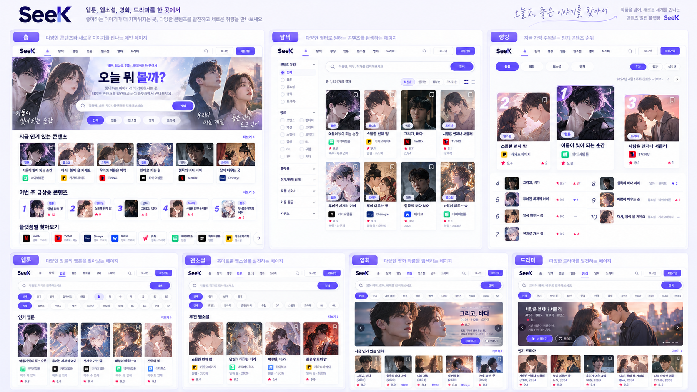
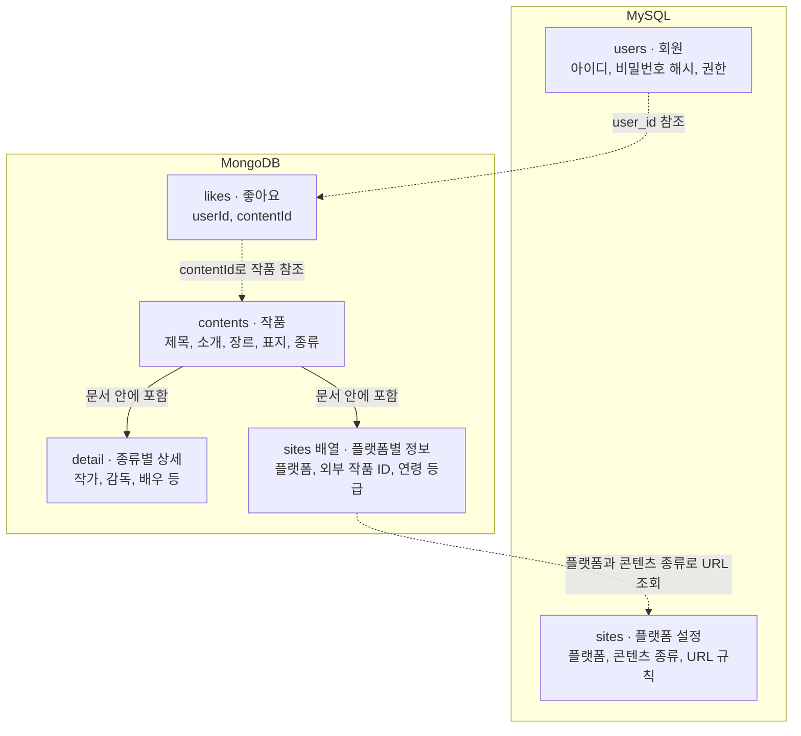

# ContentHub

웹소설, 웹툰, 영화, 드라마 정보를 수집하고 한곳에서 찾아보는 프로젝트입니다.
React로 화면을 만들고, Spring Boot API와 Python 수집·추천 서버를 연결했습니다.

## 프로젝트 소개

여러 플랫폼의 콘텐츠를 한곳에서 살펴보고 공식 작품 페이지로 이동할 수 있도록 만들었습니다.
크롤링을 직접 구현하면서 Spring Boot와 React도 함께 공부하고자 시작했습니다.
작품명·장르·콘텐츠 종류로 목록을 검색하고, 상세 화면에서 소개와 플랫폼 링크를 확인할 수 있습니다.
현재는 기능을 추가하고 기존 데이터와 API 연결을 정리하는 중입니다.

## 주요 기능

- 콘텐츠 탐색: 전체·종류별 목록, 작품명 검색, 장르 필터, 페이지 이동, 상세 모달과 공식 플랫폼 링크
- 데이터 수집: 카카오페이지·네이버시리즈 웹소설은 Selenium으로, 네이버웹툰과 웨이브 영화·드라마는 HTTP API로 수집
- 회원·좋아요 API: 회원가입, BCrypt 비밀번호 저장, JWT 로그인, 콘텐츠 ID 기준 좋아요 등록·취소·조회
- 유사 콘텐츠 추천 API: 제목·줄거리·장르와 유형별 상세 정보를 TF-IDF로 변환하고 코사인 유사도로 최대 10개 반환
- 관리자 통계: 콘텐츠 종류별 개수와 월별 가입자 수를 집계하는 API, Recharts로 구성한 통계 화면

회원 인증 확인, 좋아요, 수집, 추천은 일부 프런트엔드 요청 형식과 백엔드 API가 달라 화면 연동을 정리하고 있습니다.
찜·리뷰 저장과 실시간 채팅은 구현된 기능에 포함하지 않았습니다.
홈의 인기 영역은 현재 기본 목록의 앞 5개를 보여주며, 실제 인기 순위를 계산하지는 않습니다.

## 핵심 화면



AI로 만든 화면 디자인 예시입니다. 실제 실행 화면과는 차이가 있으며, 이미지의 랭킹·평점 등은 현재 구현된 기능이 아닙니다.

## 서비스 구조도


React에서 Spring Boot API를 호출합니다. Spring Boot는 DB 조회·저장을 맡고, 수집과 유사도 계산이 필요할 때 Python 서버에 요청합니다.

## 기술 스택
- Frontend: JavaScript, React 18, React Router — 페이지 구성과 상세 모달 이동
- Styling / HTTP: CSS Modules, Axios — 페이지별 스타일과 백엔드 요청
- Backend: Java 17, Spring Boot 3.2.2, Spring Security — 조회·수집·회원 API와 JWT 인증
- Database: MySQL·Spring Data JPA — 회원과 플랫폼 URL 설정 / MongoDB·Spring Data MongoDB — 콘텐츠와 좋아요
- 수집·추천: Python, FastAPI, Requests, Selenium — 수집 서버 / pandas, NumPy, scikit-learn — 텍스트 유사도 계산
- Build / Test: Gradle, Create React App, JUnit 5·Mockito, React Testing Library, Python unittest

## 데이터 구조

회원과 플랫폼 설정은 MySQL에, 수집한 작품과 좋아요는 MongoDB에 저장합니다.



- `contents`의 `detail`에는 웹소설 작가, 영화 감독처럼 종류에 따라 다른 정보를 넣습니다.
- 작품의 `sites` 배열에는 플랫폼별 외부 작품 ID 등을 담습니다. MySQL의 `sites` 테이블은 공식 링크를 만들 때 사용하는 URL 설정입니다.
- 좋아요는 회원 아이디와 작품 ID를 저장합니다. 점선은 코드에서 값을 참조하는 관계이며, DB 외래 키로 연결된 것은 아닙니다.

## 프로젝트 구조

```text
ContentHub/
├── frontend/src/
│   ├── pages/              # 페이지와 페이지별 스타일
│   ├── components/         # 콘텐츠 카드, 공통 UI, 관리자 화면
│   ├── services/           # 백엔드 API 요청
│   └── routes/             # 로그인·관리자 화면 접근 처리
├── backend/src/
│   ├── main/java/com/example/contenthub/
│   │   ├── content/        # 콘텐츠 모델, 검색, 수집 결과 저장
│   │   ├── auth/           # 회원가입과 JWT 인증
│   │   ├── activity/       # 좋아요
│   │   ├── recommendation/
│   │   ├── admin/
│   │   ├── user/
│   │   └── common/
│   └── test/               # 조회·저장·변환·보안 설정 테스트
└── data_pipeline/
    ├── collectors/         # 플랫폼별 수집 설정과 API·크롤러 구현
    ├── converters/         # 수집 결과 필드·자료형 변환
    ├── services/           # 수집 실행과 유사도 계산
    └── tests/
```

## 구현하면서 신경 쓴 부분

- 작품 공통 정보와 유형별 상세 정보(`detail`), 플랫폼별 정보(`sites`)를 나눴습니다. 외부 작품 ID와 내부 콘텐츠 ID도 구분했습니다.
- 검색 조건의 조합마다 Repository 메서드를 추가하는 대신, MongoTemplate으로 전달된 조건을 조립합니다.
- 같은 출처를 다시 수집하면 전체 문서를 덮어쓰지 않고 공통 메타데이터와 해당 플랫폼 정보를 부분 갱신합니다. 동시 저장으로 고유 인덱스 충돌이 나면 기존 문서를 다시 찾아 갱신합니다.
- 프런트엔드는 기본 목록을 인기 영역과 공유합니다. 요청 실패를 빈 목록과 구분해 표시하고 재시도할 수 있도록 했습니다.

## 실행 방법

Java 17, Node.js·npm, Python 3.10 이상, MySQL, MongoDB가 필요합니다.
Selenium 수집에는 Chrome도 필요합니다. 아래 명령은 프로젝트 루트 기준이며 서버별로 터미널을 나눠 실행합니다.

### 1. DB와 백엔드 설정

MySQL에 사용할 DB와 계정을 준비하고 MongoDB를 실행합니다.
`application.properties`는 저장소에서 제외되어 있으므로, `backend/src/main/resources/application.properties`를 만들고 다음 설정을 넣습니다.

```properties
spring.config.import=optional:file:.env[.properties]
spring.datasource.url=${SPRING_DATASOURCE_URL}
spring.datasource.username=${SPRING_DATASOURCE_USERNAME}
spring.datasource.password=${SPRING_DATASOURCE_PASSWORD}
spring.jpa.hibernate.ddl-auto=update
spring.data.mongodb.uri=${SPRING_DATA_MONGODB_URI}
jwt.secret.key=${JWT_KEY}
```

`backend/.env`에는 아래 값을 설정합니다. 실제 접속 정보와 키는 커밋하지 않습니다.

- `SPRING_DATASOURCE_URL`: MySQL JDBC URL
- `SPRING_DATASOURCE_USERNAME`, `SPRING_DATASOURCE_PASSWORD`: DB 계정
- `SPRING_DATA_MONGODB_URI`: 사용할 DB 이름을 포함한 MongoDB 연결 URI
- `JWT_KEY`: 32바이트 이상의 키를 Base64로 인코딩한 값

```powershell
.\gradlew.bat :backend:bootRun
```

macOS·Linux에서는 `./gradlew :backend:bootRun`을 사용합니다. 기본 포트는 `8080`입니다.

조회 시 공식 링크를 만들려면 MySQL `sites`에 플랫폼별 `platform`, `content_type`, `url_format`, `enabled` 설정이 필요합니다.
빈 DB를 자동으로 콘텐츠로 채우는 기능은 없습니다.

### 2. Python 수집·추천 서버

```shell
python -m venv .venv
# Windows: .venv\Scripts\activate
# macOS / Linux: source .venv/bin/activate
python -m pip install fastapi uvicorn requests selenium webdriver-manager pandas numpy scikit-learn
python -m uvicorn data_pipeline.app:app --host 127.0.0.1 --port 5000
```

현재 Python 의존성 버전을 고정한 파일은 없습니다.
크롤러는 `TEST_LIMIT = 2`로 수집 개수를 제한하며, 로그인 사용 여부는 플랫폼별 설정에서 관리합니다.
로그인을 켜는 경우 Python 실행 환경에 `KAKAO_ID`·`KAKAO_PWD` 또는 `NAVER_ID`·`NAVER_PWD`를 설정해야 합니다.

### 3. 프론트엔드

```shell
cd frontend
npm install
npm start
```

`http://localhost:3000`에서 확인할 수 있습니다. 개발 서버는 API 요청을 `localhost:8080`으로 프록시합니다.
